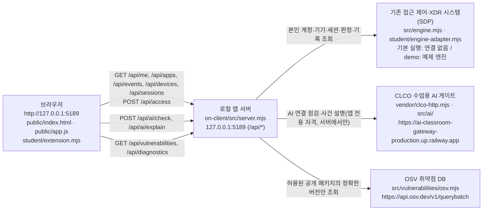

# 크툴루 보안 Agent · 학생 실행 설명서와 시스템 구성도

이 문서는 학생이 직접 작성한 문서입니다. 제공 문서(`README.md`, `docs/` 아래 다른 문서)는 고치지 않았습니다.
문서에 적은 명령과 결과는 이 PC에서 실제로 실행해 본 것만 "확인함"으로 표시했습니다. 실행하지 않은 것은 "확인 필요" 또는 "기다림(UNV)"으로 남겼습니다.
열쇠·토큰·비밀번호 같은 비밀 값은 이 문서와 저장소에 넣지 않습니다.

## 1. 무엇을 하는 앱인가

- **목적**: 직원이 자기 계정·기기·세션, 업무 앱 접근 판정, 최근 접속 기록과 XDR 경보, 앱 안 AI 설명, 조치 요청 상태, 설치 패키지 취약점 조회 결과를 한 화면에서 확인하는 보안 Agent(화면 이름 "케셰브")입니다.
- **범위**: 본인 범위의 정보만 봅니다. 전체 직원 로그, 실시간 전체 위협 탐지, 악성코드 검사·치료, 실제 조치 집행 서버는 이 앱이 하지 않습니다.
- **판정과의 관계**: 앱 화면이 잘 보인다고 단계가 통과되지는 않습니다. 공식 판정은 ALEPH 서버의 판정 AI가 제출한 커밋의 코드를 읽고 내립니다.

## 2. 지원 환경과 실제 확인한 버전

| 항목 | 수업 기준(제공 문서) | 이 PC에서 실제 확인한 값 | 확인 방법 |
|---|---|---|---|
| 운영체제 | Windows PC | Windows 11 Pro 10.0.26200 | 시스템 정보 |
| Node.js | 24.19.0 (`package.json` 의 `engines`), 22~24 지원 | v24.22.1 | `node -v` |
| npm | 별도 기준 없음(외부 의존성 없음) | 11.19.1 | `npm.cmd -v` |
| PowerShell | Windows PowerShell | 5.1.26100 | `$PSVersionTable.PSVersion` |
| Git | 커밋·제출에 필요 | 2.56.0.windows.1 | `git --version` |
| 브라우저 | PC 브라우저(1280px 이상 화면) | PC 브라우저로 화면 확인(브라우저 종류·버전은 기록하지 않음, 확인 필요) | 화면 직접 확인 |
| 외부 npm 패키지 | 없음 | 없음(`package-lock.json` 없음, `npm install` 불필요) | `package.json` 의 `dependencies` 없음 |

- 이 PC는 Node.js 24.22.1로 실행했습니다. 수업 기준 24.19.0에서의 실행은 이 PC에서 확인하지 않았습니다(확인 필요).
- macOS·Linux, 모바일 브라우저, 설치형 전체 앱(`npm run package-app`)은 확인하지 않았습니다.

## 3. 폴더 구조

Git 저장소의 최상위는 `on-client`가 아니라 그 위의 프로젝트 폴더입니다.

```
%LOCALAPPDATA%\ALEPH\Workbench\projects\크툴루-방어전\   ← Git 최상위(커밋·제출 기준)
├─ README.md                       ← 학생 README(요약)
└─ on-client\                      ← 앱 폴더(PowerShell 을 여는 위치)
   ├─ package.json                 ← start / demo / check / package-app 스크립트
   ├─ .env.example                 ← 비밀 없는 설정 견본(서버가 자동으로 읽지 않음)
   ├─ public\                      ← 제공 화면: index.html, app.js, style.css, vulnerabilities-view.mjs 등
   ├─ src\                         ← 제공 서버: server.mjs, engine.mjs, ai\, actions\, connection\, vulnerabilities\, pc-status.mjs
   ├─ vendor\clco-http.mjs         ← 제공: CLCO(AI 게이트) 요청 모듈
   ├─ tools\start-alekov.ps1       ← 제공: 실행 도구
   ├─ student\extension.mjs        ← 학생 구현(13~20단계 화면 함수 8개)
   ├─ student\engine-adapter.mjs   ← 학생 영역이지만 이번 과정에서 고치지 않음(기본: 연결 없음)
   └─ docs\STUDENT_RUNBOOK.md      ← 이 문서(학생 작성)
```

## 4. 실행·종료·다시 실행

### 4-1. PowerShell 여는 위치

1. 파일 탐색기 주소 표시줄에 `%LOCALAPPDATA%\ALEPH\Workbench\projects\크툴루-방어전\on-client` 를 붙여 넣고 Enter 를 누릅니다.
2. 같은 주소 표시줄에 `powershell` 을 입력하고 Enter 를 누르면 그 폴더에서 PowerShell 창이 열립니다.

또는 새 PowerShell 창에서 아래를 실행합니다(확인함).

```powershell
cd "$env:LOCALAPPDATA\ALEPH\Workbench\projects\크툴루-방어전\on-client"
```

다른 폴더에 저장소를 `git clone` 한 경우에는 그 폴더 안의 `on-client` 에서 같은 명령을 실행합니다. 새 폴더 재현 절차와 결과는 [STUDENT_RELEASE_RECORD.md](STUDENT_RELEASE_RECORD.md) 에 있습니다(확인함).

### 4-2. 실행 명령

| 목적 | 명령(앱 폴더에서) | 이 PC 확인 | 정상 시작 신호(창에 나오는 줄) |
|---|---|---|---|
| 예제 자료로 화면 보기 | `npm.cmd run demo` | 확인함 | `케셰브 예제: http://127.0.0.1:5189` |
| 기본 실행(기존 엔진 연결 없음) | `npm.cmd start` | 확인함 | `케셰브 연결 확인: http://127.0.0.1:5189` (문구는 `src/server.mjs` 기준) |
| 학생 파일 문법 확인 | `npm.cmd run check` | 같은 검사(`node --check student/extension.mjs`)를 단계마다 실행해 통과 | 오류 없이 끝남 |
| 제공 실행 도구 | `powershell -NoProfile -ExecutionPolicy Bypass -File .\tools\start-alekov.ps1` | 확인 필요(실행하지 않음) | 제공 문서 기준: `케셰브가 켜졌습니다. 브라우저에서 http://127.0.0.1:5189/ 을 여세요.` |

- `npm` 대신 `npm.cmd` 를 쓰는 까닭: 이 PC의 PowerShell 은 실행 정책 때문에 `npm` 을 입력하면 `npm.ps1` 이 막혔습니다. `npm.cmd` 는 같은 npm 을 실행하며 PC 설정을 바꾸지 않습니다(확인함).
- `npm run demo` 의 예제 자료는 실제 연결이나 성취가 아닙니다.
- 브라우저 주소: `http://127.0.0.1:5189` (확인함). 서버는 `127.0.0.1` 에서만 듣습니다.

### 4-3. 정상 화면

브라우저에서 위쪽 상태 표시와 「보호 현황」 화면이 보이면 정상입니다. 세 메뉴 「보호 현황」「업무 앱」「보안 기록」을 마우스와 Tab·Enter 로 오갈 수 있습니다(확인함).

### 4-4. 종료와 다시 실행

1. **종료**: 앱을 실행한 PowerShell 창에서 `Ctrl+C` 를 누릅니다. 일괄 작업을 끝낼지 물으면 `Y` 를 누릅니다(확인함). 브라우저에서 「다시 불러오기」를 누르면 연결 실패 안내가 보입니다.
2. **다시 실행**: 같은 앱 폴더에서 4-2 의 명령을 다시 실행하고, 브라우저에서 「다시 불러오기」를 직접 누릅니다(확인함). 실행·종료는 프로젝트 파일을 바꾸지 않습니다.

### 4-5. 설정 값

- 서버는 `.env` 파일을 자동으로 읽지 않고 실행 환경 변수만 읽습니다(`src/server.mjs`). `.env.example` 은 이름과 기본값을 보여 주는 견본입니다.
- 읽는 변수: `ON_PORT`(기본 5189), `ON_ENGINE_ADAPTER`, `ON_PROJECT_DIRECTORY`, `ON_APPROVED_PUBLIC_PACKAGES`, `ON_AI_MODEL` 등. 이 과정에서는 아무 변수도 바꾸지 않고 기본값으로 실행했습니다.
- `ON_PROJECT_DIRECTORY`·`ON_APPROVED_PUBLIC_PACKAGES`(취약점 조회 대상)와 SDP·AI 연결 설정은 운영자가 준비합니다. 학생이 임의로 바꾸지 않습니다.

## 5. 시스템 구성도

### 5-1. Mermaid



### 5-2. 같은 내용의 글(ASCII)

```
[브라우저] public/index.html, public/app.js, student/extension.mjs
     │  주소 http://127.0.0.1:5189 · 열쇠를 알지 못함
     ▼
[로컬 앱 서버] on-client/src/server.mjs (127.0.0.1:5189, /api/*)
     ├──▶ [기존 접근 제어·XDR 시스템(SDP)] src/engine.mjs, student/engine-adapter.mjs
     │        기본 실행: 연결 없음 · npm run demo: 예제 엔진
     ├──▶ [CLCO 수업용 AI 게이트] vendor/clco-http.mjs, src/ai/
     │        https://ai-classroom-gateway-production.up.railway.app (공개 주소, 열쇠는 서버 보관함에만)
     └──▶ [OSV 취약점 DB] src/vulnerabilities/osv.mjs → https://api.osv.dev/v1/querybatch
              (조회 대상 프로젝트·허용 패키지가 설정된 경우에만)
```

### 5-3. 상자별 표와 실제 응답 확인

| 상자 | 실제 파일·주소 | 이 PC에서 응답 확인 |
|---|---|---|
| 브라우저 화면 | `public/index.html`, `public/app.js`, `student/extension.mjs` | 확인함(화면 표시) |
| 로컬 앱 서버 | `src/server.mjs`, `http://127.0.0.1:5189/api/*` | 확인함(demo 에서 `/api/me`, `/api/apps`, `/api/access`, `/api/events`, `/api/devices`, `/api/sessions`, `/api/diagnostics` 응답) |
| 기존 접근 제어·XDR 시스템 | `src/engine.mjs`, `student/engine-adapter.mjs` | 연결 없음. demo 예제 엔진만 확인. 실제 SDP 연결은 기다림(UNV) |
| CLCO 수업용 AI 게이트 | `vendor/clco-http.mjs`, `src/ai/` | 앱 화면에서 "AI 연결 점검 실패 · 원인: 권한 준비 중" 확인. 실제 모델 응답·사건 설명은 기다림(UNV) |
| OSV 취약점 DB | `src/vulnerabilities/osv.mjs` | 조회 대상 미설정으로 "조회 준비 미완료(not_configured)" 확인. 실제 OSV 조회는 기다림(UNV) |

## 6. 제공 코드와 학생 구현 부분

시작 틀 목록 `.on-starter-manifest.json` 에 해시가 기록된 파일이 제공 파일입니다. 학생 영역은 `student/` 폴더입니다.

| 구분 | 파일 | 내용 |
|---|---|---|
| 제공 | `public/` 전체, `src/` 전체, `vendor/`, `tools/`, `docs/`(이 문서 제외), `README.md`, `package.json`, `.env.example` | 화면 틀·자료 검사·서버·연결·실행 도구. 학생이 고치지 않음 |
| 학생 | `student/extension.mjs` | 아래 8개 화면 함수를 구현(13~20단계) |
| 학생 영역(미변경) | `student/engine-adapter.mjs` | 시작 틀 그대로. 기본 연결 없음 |
| 학생 문서 | `docs/STUDENT_RUNBOOK.md`, 프로젝트 최상위 `README.md` | 21단계 문서 |

### 6-1. `student/extension.mjs` 에서 구현한 함수

제공 화면(`public/app.js`)이 자료를 검사한 뒤 각 함수에 넘기고, 함수가 돌려준 DOM 요소 하나로 학생 칸을 통째로 바꿉니다. 모든 함수는 `createElement`·`textContent` 로만 그리며 서버에 직접 요청하지 않습니다.

| 단계 | 함수 | 보여 주는 것 |
|---|---|---|
| 13 | `renderIdentity` | 현재 계정·기기·세션과 기기·세션 목록. loading/ok/error 를 나누고, 오류 때 이전 사용자 이름을 지움 |
| 14 | `renderDecision` | 고른 업무 앱의 판정 허용(allow)·거부(deny)·추가 확인 필요(challenge)·확인 불가(unknown), 판정 이유와 시각. 요청 실패는 거부 판정과 구분 |
| 15 | `renderEvents` | 본인 접속 기록·XDR 경보를 최신순으로, 「기록 종류」「업무 앱」「접속 상태」 필터, 「\<event.id\> 상세」의 근거·규칙·세 상태 |
| 16 | `renderStatus` | 기기·세션의 불러오는 중·빈 목록·실패, 알림, 도움정보 여섯 항목과 「도움정보 복사」. 기록 상세에는 미지원 조치가 넘어올 때만 「\<action\> 미지원」 비활성 버튼 |
| 17 | `renderAiConnection` | AI 연결 점검 전·중·결과(test/verified, 모델 수, 시각)와 오류 원인. "사건 설명은 아직 실행하지 않았습니다" |
| 18 | `renderExplanation` | AI 설명(참고용)을 인용 근거·규칙·현재 상태·확인 불가 목록·제안(미실행)과 함께 표시. 근거가 맞지 않으면 쓰지 않음 |
| 19 | `renderAction` | 조치 상태 idle·prepared·executing·pending·succeeded·denied·failed·unknown·expired·error 구분. `effectApplied: true` 관측 때만 효과 확인 |
| 20 | `renderVulnerabilities` | 설치 패키지의 정확한 버전과 OSV 조회 상태(complete·partial·not_checked·not_configured·unverifiable), 취약점 id·modified |

## 7. 화면 문구별 원인과 확인 순서

| 화면에 나오는 문구 | 원인 | 확인·복구 순서 |
|---|---|---|
| PowerShell: `이 시스템에서 스크립트를 실행할 수 없으므로 …npm.ps1…` | 실행 정책이 `npm.ps1` 을 막음 | `npm.cmd run demo` 처럼 `npm.cmd` 로 실행(확인함) |
| 상단 상태 "연결 없음", 학생 칸 "자료 상태: 연결 없음" | 기본 실행은 기존 엔진(SDP)에 연결하지 않음 | 정상 상태입니다. 화면 확인만 하려면 `npm.cmd run demo` |
| "자료 상태: 예제 자료" | `npm run demo` 예제 엔진 | 실제 연결이 아님을 알고 사용 |
| "로그인 정보 연결 실패: …", "기록을 불러오지 못했습니다: …", "기기 목록을 불러오지 못했습니다: …", "요청 실패: …" | 앱 서버가 꺼졌거나 응답하지 않음 | PowerShell 창에서 서버가 켜져 있는지 확인 → 다시 실행 → 「다시 불러오기」를 직접 누름(확인함) |
| "…불러오지 못했습니다(시간 초과): …" (`TIMEOUT`) | 서버 응답이 10초 안에 오지 않음 | 잠시 뒤 「다시 불러오기」를 직접 누름. 자동 재요청 없음 |
| "기록을 불러오지 못했습니다: 확인 불가(…)" (`CONTRACT_MISMATCH`) | 서버 응답이 계약 형식과 다름 | 이전 목록은 지워집니다. 도움정보를 복사해 담당자에게 전달 |
| "AI 연결 점검 실패 · 원인: 권한 준비 중" (`ON_AI_PROVISIONING_PENDING`) | 운영 측 학생 계정·앱 권한 발급 전. 학생 코드 오류 아님 | 담당자에게 계정 연결과 앱 권한 확인 요청(이 PC에서 확인함) |
| "원인: 인증 실패" / "접근 제한" | 계정 연결 또는 이용 권한 문제 | 보호 현황의 계정 연결 다시 확인 → 담당자 확인. 열쇠를 복사하지 않음 |
| "원인: 사용량·이용 한도" / "이용 시간 아님" | 반 사용량·한도 또는 이용 시간 밖 | 담당자 확인 / 이용 시간 확인 |
| "원인: 요청 제한·시간 초과·네트워크" | 요청 제한·시간 초과 | 잠시 뒤 「AI 연결 점검」을 직접 다시 누름 |
| "원인: 취소" | 「AI 연결 점검 취소」를 누름 | 이전 결과는 현재 결과가 아님. 필요하면 다시 점검 |
| "원인: 쓸 수 있는 모델 없음" | 앱 권한으로 허용된 모델 없음 | 담당자에게 모델 허용 설정 확인 요청 |
| "AI 설명 실패: …" + "근거 부족" (`ON_AI_INVALID_INPUT`) / "근거가 맞지 않음" (`ON_AI_INVALID_OUTPUT`) | 기록의 근거·규칙 부족 / AI 응답의 근거 ID·형식 불일치 | 기록은 그대로입니다. 다른 기록을 고르거나 담당자 확인. 과제 실패 아님 |
| "조회 실패: …" (패키지) | 설치 패키지 조회 응답 실패·취소 | 「설치 패키지 조회」를 직접 다시 누름. 실패는 "취약점 없음"이 아님 |
| "조회 준비 미완료(not_configured)" / "아직 조회 안 함(not_checked)" | 조회 대상 프로젝트 미설정 / 승인된 공개 조회 대상 없음 | 운영자가 설정합니다. 학생이 의존성을 낮추거나 설정을 바꾸지 않음(not_configured 확인함) |
| "요청 처리 안 됨(error)" + `ACTION_UNSUPPORTED` 등 | 연동 시스템의 조치 연결·권한 없음 | 시험 집행을 하지 않습니다. 담당자 안내 대기 |
| "결과 불명(unknown)" (조치) | 전달 뒤 결과를 확인하지 못함 | 다시 집행하지 말고 「원천 결과만 재조회」를 직접 누름 |
| 포트 5189 를 이미 다른 프로그램이 사용 | 다른 프로그램이 같은 포트 사용 | 제공 실행 도구는 `-Port 5190` 으로 다른 포트 실행을 안내(제공 문서 기준, 이 PC에서는 확인 필요) |

## 8. 지원 범위: 확인한 것과 기다림(UNV)

### 8-1. 이 PC의 실제 화면에서 확인한 것

| 단계 | 확인한 기능 |
|---|---|
| 13 | demo 계정·기기·세션 표시, 다시 불러오기 뒤 새로 그려짐, 서버를 끄면 연결 실패·이전 사용자 이름 사라짐, 세 메뉴 마우스·Tab·Enter 이동 |
| 14 | 학습 자료실 허용, 개발 저장소 거부, 확인할 업무 앱 추가 확인 필요(키보드 선택 포함), 서버를 끄면 요청 실패·이전 판정 사라짐 |
| 15 | 기록 1건 표시, 필터 적용·해제 뒤 건수 일치, 상세의 근거·규칙·세 상태(unknown 은 확인 불가), 다시 불러오면 상세 사라짐, 서버를 끄면 조회 실패 |
| 16 | 도움정보 복사 내용이 여섯 항목뿐이고 비밀 값 없음, 실패 안내와 직접 다시 불러오기 뒤 사라짐 |
| 17 | 연결 전 점검 "권한 준비 중", 다시 불러오면 "AI 연결 점검 전"으로 돌아감 |
| 18 | AI 설명 실패 화면, AI 실패 중에도 기록 목록·업무 앱 판정이 그대로 동작 |
| 19 | 지금 기록에서 조치 칸 "아직 미실행(idle)", 「조치 준비」 버튼 없음 |
| 20 | 설치 패키지 조회 "조회 준비 미완료(not_configured)"와 제공 화면 값 일치 |

### 8-2. 모의 입력으로만 점검한 것(실제 화면 아님)

가짜 DOM 으로 상태별 표시를 점검했습니다: 판정 unknown, 여러 기록 필터·XDR 경보·빈 목록, 미지원 조치 버튼, AI 오류 원인 12종·test/verified 결과, AI 설명 성공·근거 불일치 거부, 조치 상태 10종과 효과 미관측 시 결과 불명, 패키지 다섯 가지 조회 상태·정확한 버전·일부 실패 ID 유지.

### 8-3. 기다림(UNV): 아직 실제로 확인하지 못한 기능

- 실제 기존 접근 제어·XDR 시스템(SDP) 연결과 실제 사용자·기기·판정·기록
- 보호 현황 계정 연결 승인 완료, 앱 AI 연결 완료(test/verified), 실제 모델 응답과 AI 사건 설명 성공
- 조치 준비·사람 확인·집행·효과 관측(연동 시스템 집행기 미연결, 실제 학생 계정의 조치 결과는 기다림)
- 실제 OSV 조회 결과, `package-lock.json` 버전 대조, 취약점 ID 표시
- 점검·조회 중 취소(응답이 빨라 재현하지 못함), 네트워크 탭에서의 자동 재요청 없음 확인
- `tools\start-alekov.ps1` 실행, Node.js 24.19.0 에서의 실행, 다른 포트 실행
- 설치형 전체 앱(`npm run package-app`)과 바탕화면 바로가기 실행

## 9. 커밋과 21단계 제출

1. 프로젝트 최상위(`크툴루-방어전`)에서 학생 문서를 커밋합니다. 다른 변경이 있으면 먼저 내용을 확인하고 보존합니다.
2. 이 저장소(`https://github.com/ddonni/kutulu`)는 공개 저장소입니다. 21·22단계는 과제 화면에 저장소 주소와 40자리 커밋을 직접 입력해 제출합니다. 비공개 저장소용 원문 전달 도구는 이 저장소에서는 쓰지 않았습니다.
3. 제출 버튼은 학생이 직접 누릅니다. 원문 전달 완료와 AI 검토 통과는 다르므로 판정 설명을 확인합니다.
